# Briefing

**Language: [English](README.md) | [한국어](README.kr.md)**

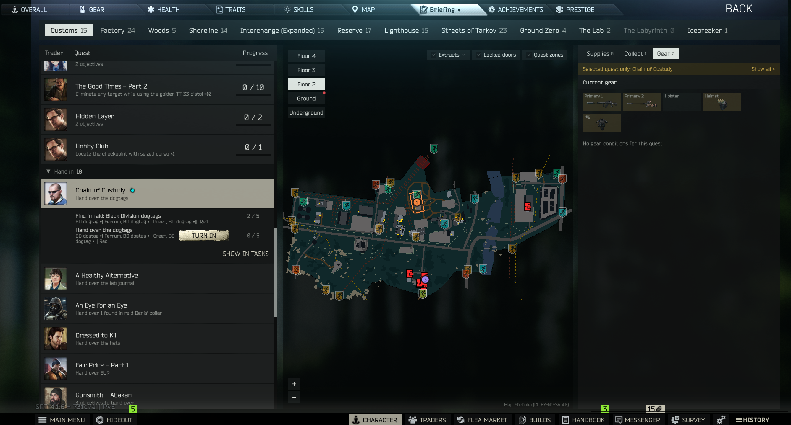

## 모드 취지

레이드에 나가기 전에 확인할 것들(**이 맵에서 할 퀘스트, 목표 위치, 챙길 아이템, 퀘스트가 요구하는 장비**)을
캐릭터 화면 안의 **브리핑** 탭 한 화면에서 보는 클라이언트 모드입니다.

데이터는 [QuestCodex](https://github.com/Viper-9/QuestCodex) 서버 모드에서 받습니다. 그래서 QuestCodex 웹의
레이드 준비 화면과 같은 계산 결과를, 브라우저를 따로 띄우지 않고 게임 안에서 보게 됩니다. 퀘스트 모드가 바꾸거나
추가한 퀘스트도 QuestCodex가 읽은 그대로 나옵니다.

## 요구사항

- SPT `~4.1.6`
- **[QuestCodex](https://github.com/Viper-9/QuestCodex) 1.8.0 이상** (서버 모드). 브리핑 데이터와 지도 파일을 QuestCodex가 제공합니다.
  QuestCodex가 없으면 탭 안에 "QuestCodex가 필요합니다" 안내만 나옵니다.

## 설치

1. QuestCodex 1.8.0 이상을 먼저 설치합니다.
2. [Releases](../../releases)에서 원하는 버전의 `Briefing-<버전>.zip`을 다운로드합니다.
3. 압축을 풀어 나오는 `BepInEx` 폴더를 SPT 설치 루트(`EscapeFromTarkov.exe`가 있는 폴더)에 그대로 덮어씁니다.
   (`BepInEx/plugins/Briefing/...` 구조)
4. 서버와 게임을 재시작합니다.

## 여는 법

캐릭터 화면 탭 줄의 **임무(TASKS) 탭**이 드롭다운으로 바뀝니다. 탭을 눌러 펼친 뒤 **브리핑(Briefing)**을 고르면 브리핑 화면이
열리고, **임무(TASKS)**를 고르면 원래 임무 탭으로 돌아갑니다.

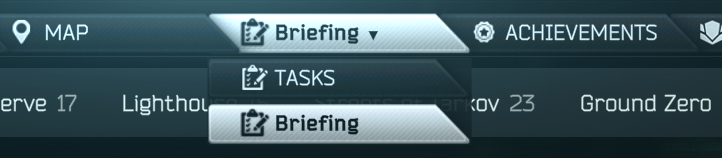

화면 문구는 게임 언어를 따릅니다. 한국어·러시아어를 지원하고, 그 밖의 언어는 영어로 나옵니다.

## 기능

화면은 위쪽 **맵 선택 줄**과 그 아래 3열(퀘스트 목록 · 지도 · 준비물/수집/장비)로 되어 있습니다.
맵 이름 옆 숫자는 그 맵에서 할 목표 수이고, 목표가 없는 맵도 지도·탈출구를 보려고 누를 수 있습니다.

### 퀘스트 목록

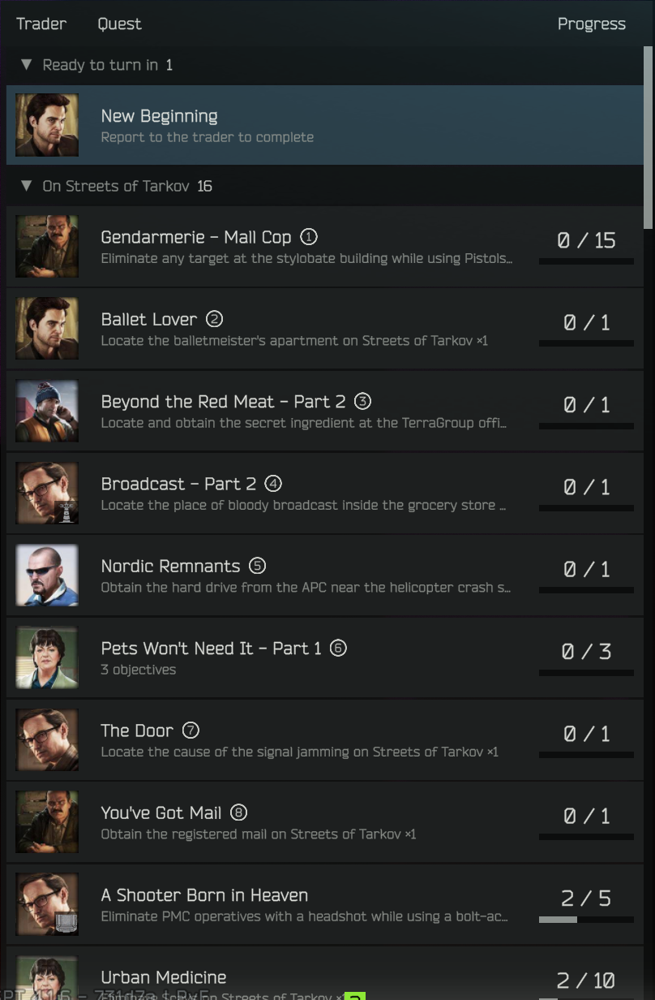

- **이 맵에서** 할 퀘스트와, 맵 상관없이 할 수 있는 **아무 맵에서나** 묶음을 상인 얼굴·목표 요약·진행 수치·막대와 함께 보여 줍니다.
- 이 맵 퀘스트 이름 옆 번호(①②③…)는 지도 위 마커 번호·색과 같습니다.
- 레이드 밖에서는 두 묶음이 더 붙습니다.
  - **완료 가능**: 맨 위. 상인에게 보고만 하면 끝나는 퀘스트.
  - **제출**: 아이템 건네주기 목표가 남은 퀘스트. 지금 건네줄 수 있는 퀘스트는 이름 뒤에 하늘색 손 아이콘이 붙습니다.

### 퀘스트 펼침 · 건네주기 · 완료하러 가기

퀘스트 줄을 누르면 그 퀘스트의 목표가 게임 순서대로 펼쳐집니다. 대상 아이템 이름도 아래에 작게 나옵니다.

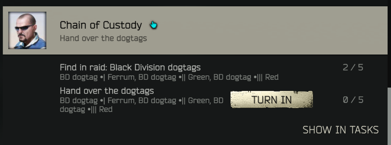

- **건네주기(TURN IN)**: 건네주기 목표 줄의 버튼으로 게임과 똑같이 아이템을 제출합니다. 제출이 끝나면 브리핑이 바로 갱신됩니다.
- **임무 탭에서 보기(SHOW IN TASKS)**: 임무 탭으로 넘어가 그 퀘스트를 펼쳐 둡니다.

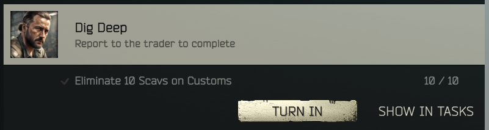

- **완료 가능** 퀘스트의 **완료하러 가기** 버튼은 그 상인의 임무 화면을 열고 퀘스트를 골라 둡니다. 완료 버튼은 직접 누르고,
  상인 화면을 닫으면 브리핑 탭으로 돌아옵니다.
- 펼친 퀘스트는 지도에서 강조되고 오른쪽 열도 그 퀘스트 것만 보여 줍니다(아래 [선택한 퀘스트만 보기](#선택한-퀘스트만-보기)).

### 지도

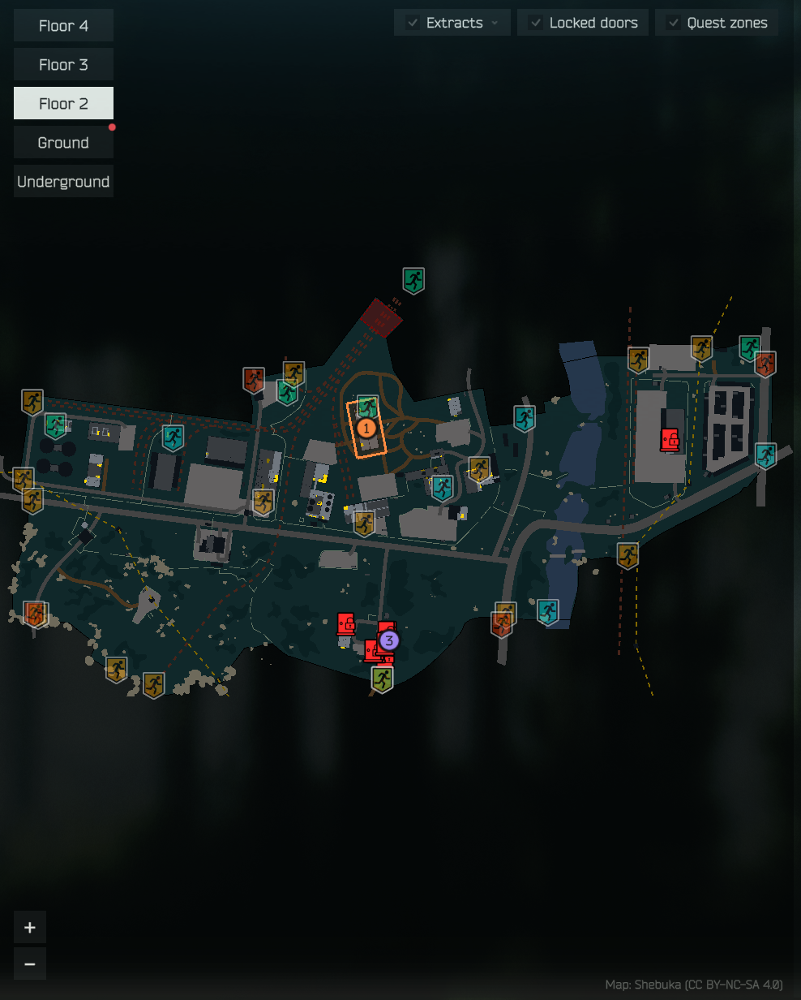

- 퀘스트 마커·퀘스트 구역·탈출구·잠긴 문을 한 지도에 표시합니다. 탈출구와 잠긴 문은 마우스를 올리면 이름·조건·열쇠 이름이 나옵니다.
- 위쪽 체크박스로 **탈출구(PMC / 스캐브 / 환승) · 잠긴 문 · 퀘스트 구역**을 켜고 끕니다.
- 층 버튼으로 층을 바꿉니다. 다른 층에 퀘스트 마커가 있으면 그 층 버튼에 빨간 점이 찍힙니다.
- 휠로 확대·축소, 끌어서 이동, 더블클릭으로 원래대로, `+` / `−` 버튼도 있습니다.
- 퀘스트 줄에 마우스를 올리면 그 퀘스트 마커만 강조되고, 지도 마커를 누르면 목록에서 그 퀘스트로 이동합니다.
- 지도는 QuestCodex가 제공하는 SVG를 게임 안에서 그립니다. 처음 연 뒤에는 나머지 맵 지도도 뒤에서 미리 그려 둡니다.

### 준비물

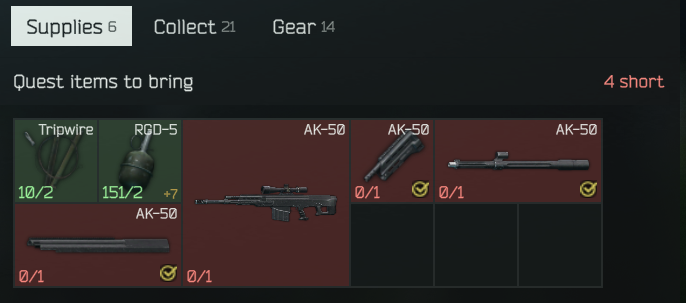

레이드에 **가져가야 할** 퀘스트 아이템(설치할 아이템 등)을 게임 아이콘 격자로 보여 줍니다. 칸마다 보유/필요 수량이 있고,
모자라면 빨간 칸, 충분하면 초록 칸입니다. 머리줄 오른쪽에 부족한 줄 수가 나옵니다.

### 수집

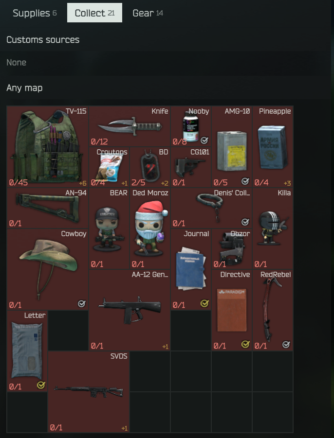

레이드에서 **찾아와야 할** 아이템입니다. 이 맵에서 나오는 것을 먼저, 그다음 아무 맵에서나 구할 수 있는 것을 보여 줍니다.
FIR 표시·퀘스트 아이템 표시는 게임 보관함과 같은 그림을 쓰고, 대안 아이템이 있으면 `+N` 이 붙습니다.
마우스를 올리면 전체 이름·대안·요구 퀘스트가 나옵니다.

### 장비

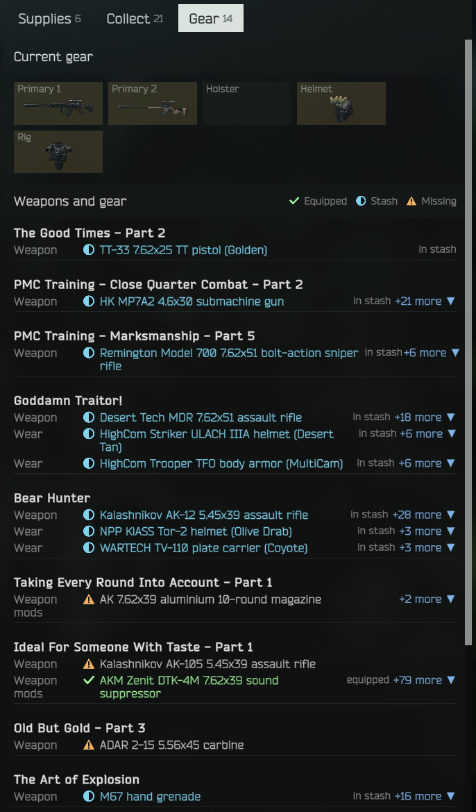

- **현재 장비**: 지금 장착한 주무기·권총·헬멧·방탄복(조끼).
- **무기·장비 조건**: 퀘스트가 요구하는 무기·구경·부착물·착용 장비를 현재 장비와 대조해 줄마다 표시합니다.
  - ✓ 장착 중 · ◐ 보관함에 있음 · ⚠ 없음
  - 대안이 많으면 `외 N종 ▼` 로 접혀 있고, 누르면 전체 목록이 열립니다.
- **특수 조건**: 한 레이드 안에 완료, 생존 탈출·특정 탈출구 같은 조건.

### 선택한 퀘스트만 보기

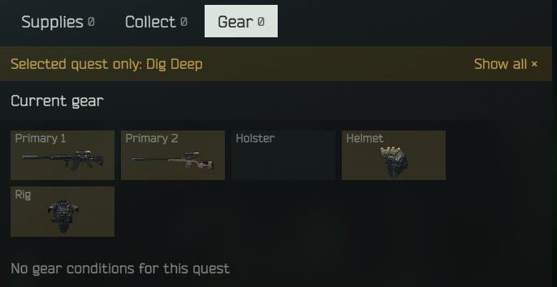

퀘스트를 펼치면 준비물·수집·장비 세 탭이 모두 그 퀘스트 것만 보여 줍니다. 위쪽 금색 띠의 **전체 보기 ×**를 누르면
펼침은 그대로 두고 필터만 끕니다.

### 열 폭 조절

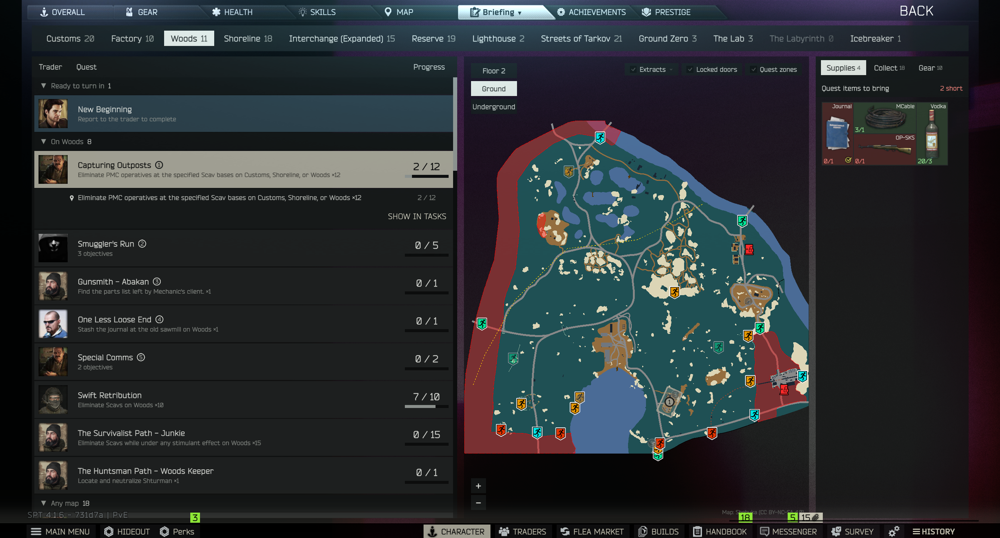

열 사이 경계를 끌어서 퀘스트 목록·지도·오른쪽 열의 폭을 바꿉니다. 더블클릭하면 기본 폭으로 돌아가고,
바꾼 폭은 저장되어 게임을 다시 켜도 유지됩니다.

### 레이드 중

- 레이드 중에 탭을 열면 **현재 맵이 자동으로 선택**되고 "레이드 중" 표시가 붙습니다. 다른 맵도 누를 수 있습니다.
- 처치 수 같은 레이드 목표 진행은 **실시간**으로 갱신되고, 끝난 목표는 흐리게 바뀝니다.
- 장비 판정은 현재 장착 기준이라, 레이드에서 주운 무기로 바꾸면 바로 반영됩니다.
- 레이드 중에는 서버에 요청하지 않고, 레이드 로딩 때 받아 둔 데이터를 씁니다.

## 설정

BepInEx 설정 파일 `BepInEx/config/com.viper.briefing.cfg` 의 `Layout` 섹션:

| 항목 | 기본값 | 설명 |
|---|---|---|
| `Side margin` | 20 | 브리핑 화면 좌우 여백 |
| `Top margin` | 8 | 탭 줄과 화면 위쪽 사이 여백 |
| `Bottom margin` | 40 | 아래쪽 메뉴 막대를 피하는 여백 |
| `Left column width` | 0 | 퀘스트 목록 폭 (0 = 기본 540). 열 경계를 끌면 저장 |
| `Right column width` | 0 | 오른쪽 열 폭 (0 = 기본 470). 열 경계를 끌면 저장 |

## 알려진 한계

- **레이드 밖의 진행 수치는 서버 기준입니다.** SPT는 레이드가 끝나야 진행을 서버에 저장하므로, 메뉴의 수치는 마지막 레이드가
  끝난 시점 값입니다(레이드 중에는 게임에서 직접 읽어 실시간으로 바뀝니다).
- **장비 판정은 조건 줄마다 따로 합니다.** 게임은 "이 무기에 이 소음기를 달고 처치"처럼 한 무기에 조건을 묶지만, 브리핑은
  무기와 부착물을 각각 판정합니다. 그래서 소음기가 다른 무기에 달려 있어도 ✓ 가 될 수 있습니다.
- **탈출구 이름은 모든 언어에서 영어**입니다(tarkov.dev 이름).
- QuestCodex의 한계를 그대로 물려받습니다. 런타임에 응답을 후킹하는 퀘스트 모드의 변경은 보이지 않습니다
  ([QuestCodex 알려진 한계](https://github.com/Viper-9/QuestCodex#알려진-한계) 참고).
- Fika 환경은 확인하지 않았습니다.

## 라이선스

Copyright (c) 2026 Viper-9. **All Rights Reserved.**

이 모드를 개인적·비상업적 용도로 **원본 그대로** 내려받아 사용할 수 있습니다. 재배포(다른 곳에 재업로드
포함), 수정, 2차적 저작물 제작, 상업적 이용은 저작권자의 사전 서면 허락 없이는 금지됩니다. 전체 조항은
[LICENSE](LICENSE.md)를 참고하세요.

제3자 구성요소는 각자의 라이선스를 따릅니다. [THIRD_PARTY_NOTICES](THIRD_PARTY_NOTICES.md)를 참고하세요.
스크린샷 속 지도는 QuestCodex가 제공하는 지도로, 저작자·라이선스는 지도 칸 오른쪽 아래에 표시됩니다.
